# ClaimWillow

**Insurance claims workflow and test automation platform** for a fictional home-contents insurer: policyholders
submit claims for damaged or lost belongings, deterministic rules check them, adjusters review and decide, and every
step lands in an append-only audit trail. Covered end to end by unit, integration, frontend and Cucumber/Selenium
browser tests.

> **Synthetic data only.** All people, policies, claims and files are fictional. ClaimWillow is a portfolio
> application — not a licensed insurance platform or a production claims-decision system. Do not enter real personal
> or insurance information.

## Live demo

**https://claimwillow.onrender.com** runs on Render's free plan, with the database on a free Neon PostgreSQL project
([render.yaml](render.yaml), [deployment guide](docs/DEPLOYMENT.md#3-free-hosting-render--neon-live-deployment)).

The landing page has three one-click demos: **Try as a policyholder (Priya)**, **Try as an adjuster (Dana)** and
**Try as an admin**. Each signs in through the normal login API and opens that role's home screen. To use the form
instead, sign in with a username and the shared password **`demo1234`**; the sign-in page lists the same accounts.

| Username | Password | Role | What to try |
| --- | --- | --- | --- |
| `priya` | `demo1234` | Policyholder | Submit a new claim, answer an information request, follow the status and history |
| `marcus` | `demo1234` | Policyholder | A claim waiting for more information, a closed claim and an over-limit claim with the rule findings that explain it; a link to one of Priya's claims shows "not found" |
| `dana` | `demo1234` | Adjuster | Work the queue: assign, review, request information, approve or reject, close |
| `sam` | `demo1234` | Adjuster | Try to act on Dana's claim and see the server refuse it |
| `admin` | `demo1234` | Administrator | Reassign claims, see reports and the CSV export, enable or disable accounts |

> **Synthetic data only.** Every account, policy and claim is fictional, and the password is public on purpose. Do not
> enter real personal information or upload real documents. The demo data may be reset at any time.

> **First load can take a minute or two.** The free host sleeps after 15 minutes without visitors. The first request
> after that wakes the service and starts the JVM, which takes about a minute, sometimes nearly two (one wake-up on
> 2026-11-12 took 111 s). After that it responds normally.

### Try it in 3 minutes

1. Open the live demo and choose **Try as a policyholder (Priya)** (or sign in as **`priya`** / `demo1234`). Choose **New claim**, pick policy HC-100421, fill in the incident, a title, a description
   and an estimate, then **Review claim** → **Submit claim**. Note the reference and the automated checks.
2. Sign out and sign in as **`dana`**. Find the claim in the **Work queue**, open it, then **Assign to me** →
   **Start review** → **Request more information** with a short message.
3. Sign in as **`priya`** again. Open the claim, write a response (attach a small PNG or PDF if you like) and send it.
4. Sign in as **`dana`**. Read the response, **Record a decision** → Approve with a note, then **Close claim**. The
   **History** panel lists every step with its actor and time.

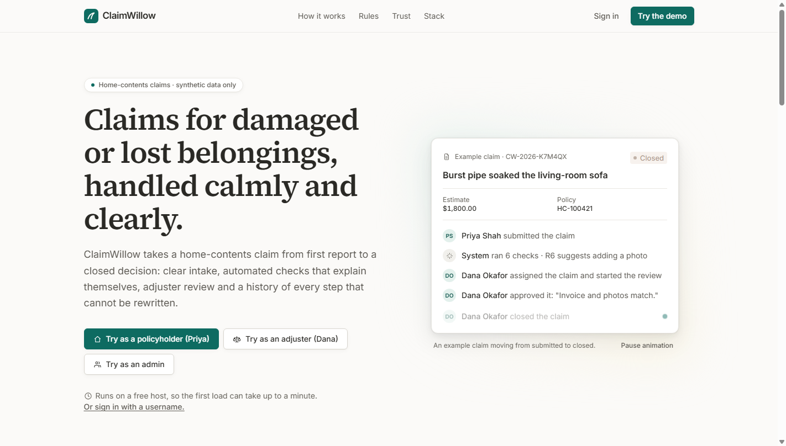

## The problem

Claims teams need structured intake, coverage and duplicate checks, assignment, requests for missing information,
recorded decisions and a clear history. Spreadsheets and email threads lose that trail. ClaimWillow puts the whole
flow in one small, secure web application with tests that prove the rules.

## Who uses it

| Role | Can do |
| --- | --- |
| **Policyholder** | Save and submit claims against their own policies, attach evidence, answer information requests, follow status and history. Anyone else's claim shows "not found" |
| **Claims adjuster** | Work the queue and reports, take an unassigned claim, add internal notes and evidence to open claims. Start review, request information, approve or reject (with a mandatory note) and close only on claims **assigned to them** |
| **Administrator** | Queue, reports and notes like an adjuster, plus: take over any open claim, even one assigned to someone else (the API also lets an admin assign it to a named adjuster); close any decided claim; enable or disable accounts. Start review, request information and decide still require being the assigned adjuster |

## Features

- **Landing page with one-click demos** — how a claim flows, the six rules, the audit/security/testing approach and
  the stack, with quiet scroll fade-ins and an animated example claim (pausable, and static when the system asks for
  reduced motion). Demo buttons sign in as Priya, Dana or the admin through the normal login API, CSRF included.
- **Calm workspace UI** — a role-based sidebar (a drawer on phones), page-style claim screens with breadcrumbs and a
  property list, rule findings as callouts, a quiet activity feed and database-style tables with compact filters.
  Self-hosted fonts, WCAG AA colour contrast, visible focus, keyboard-usable controls.
- **Claim intake** — three-section form (policy · incident and amount · evidence), manual draft save, a review step
  before submission, field-level errors from both the client and the server.
- **Deterministic rules R1–R6** (no AI): required inputs (blocking), policy active on the incident date, estimate over
  the coverage limit, at or below the deductible, potential duplicates (owner-scoped), completeness. Rules are named,
  versioned, explained in the UI and stored per validation run. Findings never reject a claim on their own.
- **Immutable policy snapshot** copied onto the claim at submission.
- **Review lifecycle** — `DRAFT → SUBMITTED → IN_REVIEW ⇄ NEEDS_INFO → APPROVED/REJECTED → CLOSED`; illegal transitions
  return 409; actions shown are computed by the server for the viewer's role and the claim's status.
- **Concurrency safety** — every action carries the version the user saw; conflicting assignments or decisions get a
  clear 409 with a refresh option, never a silent overwrite.
- **Append-only audit trail** — status changes, notes, evidence and rule runs, written in the same transaction as the
  change; database triggers block UPDATE/DELETE.
- **Private evidence** — PDF/PNG/JPEG checked by magic bytes, 5 MB limit, random storage keys, role-checked
  downloads.
- **Work queue** — three counts (new, in review, needs info), filters by status, assignee, reference/title/policy
  and submitted date, sorting, pagination.
- **Reports** — status counts and a formula-safe CSV export from the live database; small account admin screen.
- **Security** — server-side sessions, CSRF tokens, BCrypt, login throttling, strict security headers, 404 instead of
  leaking other users' data. See [docs/SECURITY.md](docs/SECURITY.md).

## Screenshots

Captured from a freshly seeded instance by `e2e/src/test/java/com/claimwillow/e2e/ScreenshotTour.java`, which also
clicks the adjuster demo button end to end.

| | |
| --- | --- |
|  Landing page | 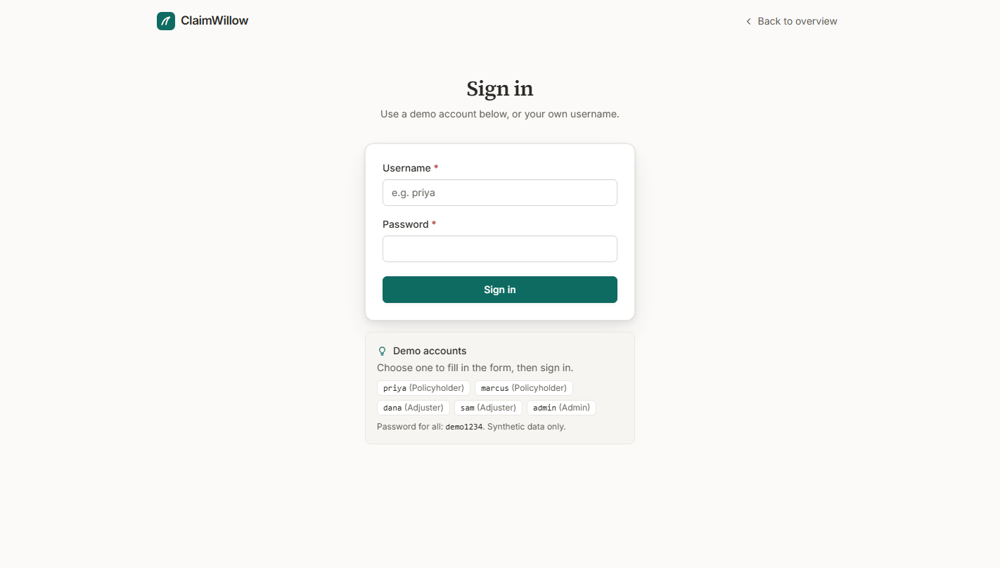 Sign in |
| 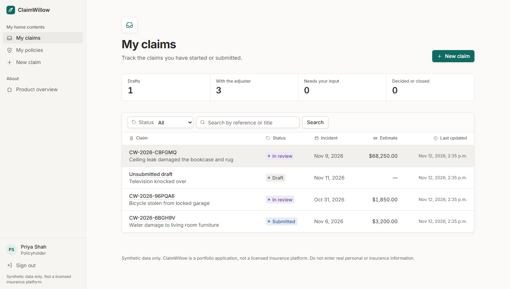 My claims | 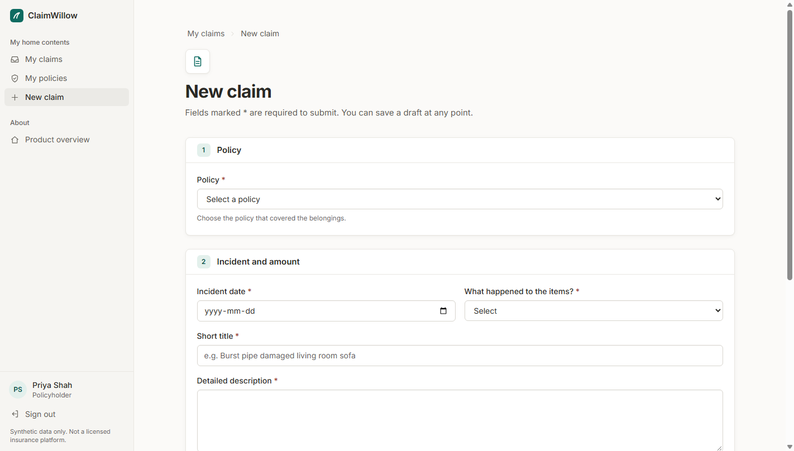 New claim form |
| 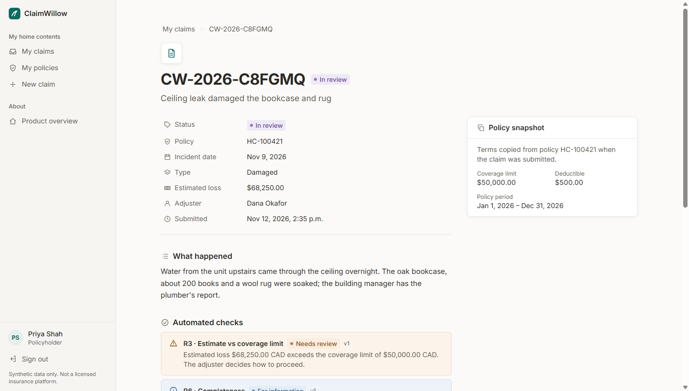 Claim detail (policyholder) | 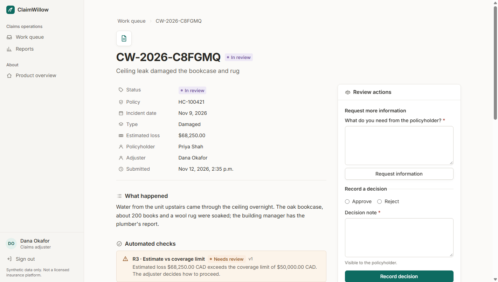 Claim detail with review actions (adjuster) |
| 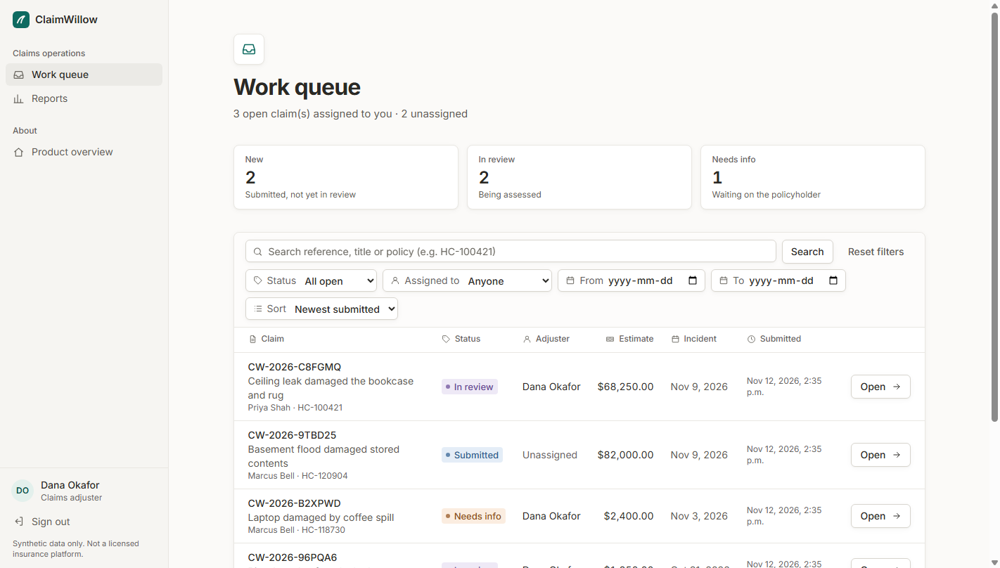 Work queue | 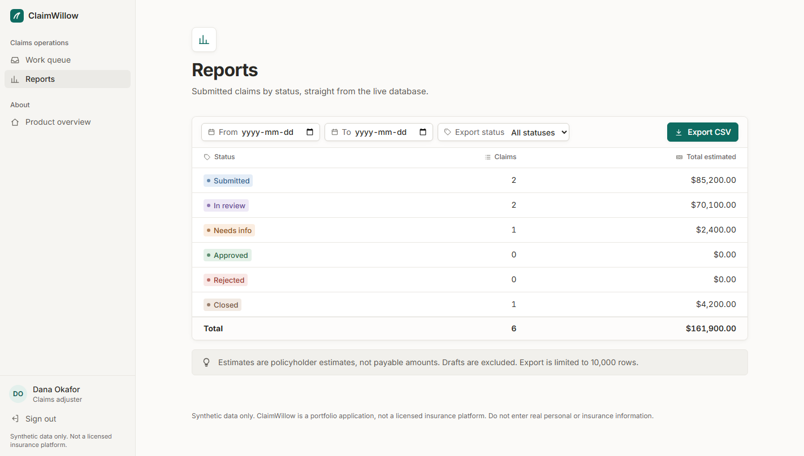 Reports |
| 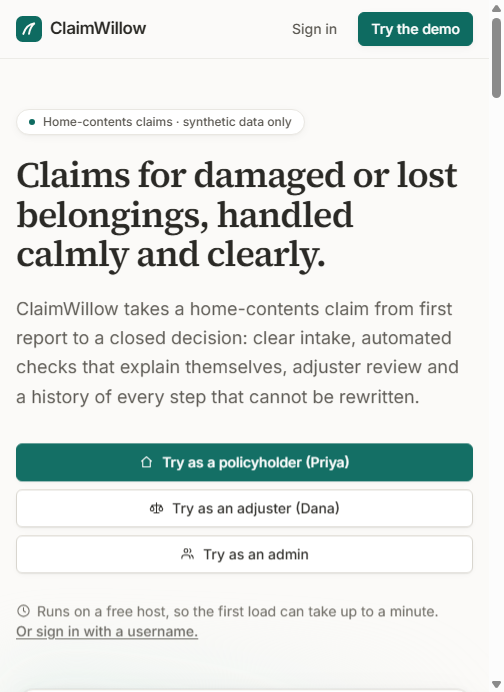 Landing page, phone | 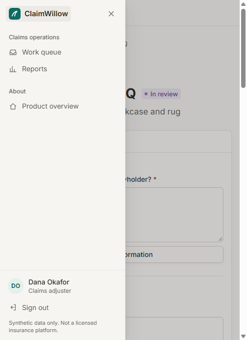 Navigation drawer, phone |
| 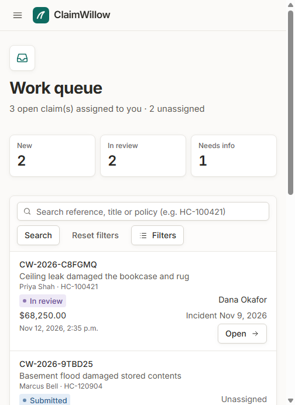 Work queue, phone | 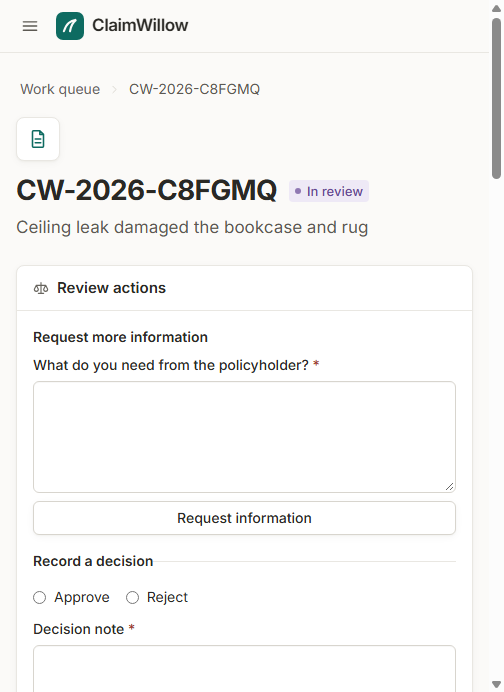 Review actions, phone |

## Architecture

A modular monolith: one Spring Boot application serves the React app and the `/api/v1` REST API from the same origin,
backed by one PostgreSQL database and private evidence storage behind an interface.

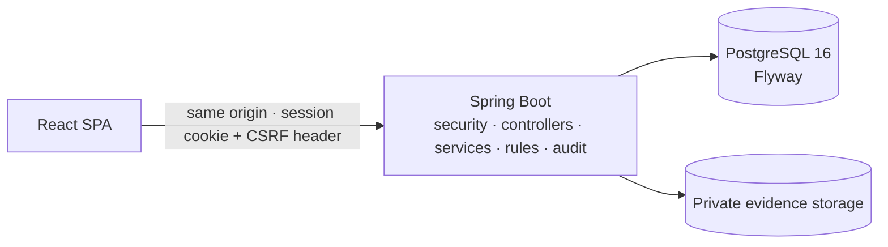

Details, data model, trust boundaries and design reasons: [docs/ARCHITECTURE.md](docs/ARCHITECTURE.md).

## Tech stack

| Area | Choice (version) | Why |
| --- | --- | --- |
| Backend | Java 21, Spring Boot 4.1.2 (Spring Security 7, Spring Data JPA, Hibernate 7.4, Bean Validation) | Current supported Spring Boot line from Spring Initializr; mature security and transactions |
| Database | PostgreSQL 16, Flyway 12.4 | Constraints, triggers and NUMERIC money; versioned migrations |
| API docs | springdoc-openapi 3.2 | OpenAPI at `/v3/api-docs`, Swagger UI in development |
| Frontend | React 19.3, TypeScript 6.0, Vite 8.3, React Router 7.18, TanStack Query 5, Tailwind CSS 4.3, Inter and Source Serif 4 via Fontsource | Typed SPA, server state via queries, small design-token system; fonts are bundled, so the strict CSP needs no font CDN |
| Backend tests | JUnit Jupiter 6, Mockito, AssertJ, Spring Boot Test, Testcontainers 2.0 | Real PostgreSQL in integration tests |
| Frontend tests | Vitest 5.1, React Testing Library 16, user-event | Component and form behaviour |
| Browser tests | Cucumber 7.34 (Gherkin), Selenium 4.52 with headless Chrome | Readable scenarios against the real app |
| Build/ops | Maven Wrapper, npm, Docker multi-stage image, Docker Compose, GitHub Actions | Reproducible local and CI runs |
| Hosting | Render free web service (Docker) + Neon PostgreSQL (live); Azure Container Apps documented as an alternative | One container, one managed database, free plans |

## Run it locally

Prerequisites: **Java 21**, **Node 24**, **Docker**. Ports used: PostgreSQL `5434`, backend `8080`, Vite `5173`.

### Option A — everything in Docker (production image)

```bash
docker compose -p claimwillow up --build        # http://localhost:8080
docker compose -p claimwillow down              # stop (add -v to delete local data)
```

### Option B — development mode (hot reload)

```bash
docker compose -p claimwillow up -d db          # PostgreSQL on localhost:5434

cd backend
./mvnw spring-boot:run -Dspring-boot.run.profiles=local      # Windows: .\mvnw.cmd spring-boot:run "-Dspring-boot.run.profiles=local"

cd frontend
npm install
npm run dev                                     # http://localhost:5173 (proxies /api to :8080)
```

The Vite dev server proxies `/api` to Spring Boot, so the browser sees one origin: the session cookie and the
`XSRF-TOKEN` cookie work exactly as in production. The `local` profile connects to the Docker database and seeds the
synthetic demo data (idempotent: policies and claims are created once; the five demo accounts get their name, role
and password re-applied on every start).

### Demo accounts

The same five accounts as the live demo. Password for every account: `demo1234`, the default in
`application-local.yml` and `docker-compose.yml`. A hosted `prod` deployment sets it with `APP_SEED_DEMO_PASSWORD`
(seeding is skipped if it is missing or shorter than 8 characters; see [docs/SECURITY.md](docs/SECURITY.md)).

| Username | Role | Seeded data |
| --- | --- | --- |
| `priya` | Policyholder | Two policies (one expired), claims in several states, one draft |
| `marcus` | Policyholder | Two policies; a claim waiting for more information, a closed claim, an over-limit claim in the queue |
| `dana` | Adjuster | Has claims in review |
| `sam` | Adjuster | Closed one of the claims |
| `admin` | Admin | Account screen, reassignment |

### Configuration

All settings are environment variables with Spring conventions; see [.env.example](.env.example) (placeholders
only) and [docs/DEPLOYMENT.md](docs/DEPLOYMENT.md). Main ones: `SPRING_PROFILES_ACTIVE`, `SPRING_DATASOURCE_URL`,
`SPRING_DATASOURCE_USERNAME`, `SPRING_DATASOURCE_PASSWORD`, `SESSION_COOKIE_SECURE`, `APP_SEED_DEMO_DATA`,
`APP_SEED_DEMO_PASSWORD`, `ATTACHMENT_STORAGE_MODE` (`local`, `database` or `azure`), `ATTACHMENT_LOCAL_DIR`, `PORT`,
`JAVA_TOOL_OPTIONS`.

## Tests

| Layer | Command | Latest local result |
| --- | --- | --- |
| Backend unit | `cd backend && ./mvnw test` | 75 passed |
| Backend integration (Testcontainers PostgreSQL) | `cd backend && ./mvnw verify` | 60 passed |
| Frontend (lint, tests, build) | `cd frontend && npm ci && npm run lint && npm test -- --run && npm run build` | lint clean, 43 passed, build ok |
| Browser acceptance (Cucumber + Selenium) | build jar and frontend, then `cd e2e && ./mvnw test` | 10 scenarios, 96 steps passed |

Integration and browser tests start their own disposable PostgreSQL containers (Docker required) and never touch the
development database. The browser suite boots the real backend jar serving the built frontend. Full details,
scenario list and CI stages: [docs/TESTING.md](docs/TESTING.md). CI runs backend and frontend jobs for every code change,
adds the browser and Docker image jobs when the app or tests change, and skips everything for documentation-only
changes ([.github/workflows/ci.yml](.github/workflows/ci.yml)).

## Demo walkthrough (about 4 minutes)

1. **Open the landing page** and choose **Try as a policyholder (Priya)** (or sign in with `priya` / `demo1234`).
   *My claims* shows counts by status and the list.
2. **New claim** → choose policy HC-100421, set a date, "Damaged", a title, a short description and an estimate of
   `65000`. **Save draft**, refresh the page (the draft is still there), **Review claim** → **Submit claim**.
3. The claim page shows the reference, *Submitted*, and **Automated checks**: R3 (over the 50,000 limit) and R6
   (short description, no evidence), each explained. **History** shows the submission and the rule run.
4. **Sign out, sign in as Dana** (`dana`). The **Work queue** shows the new claim; search by its
   reference and **Open** it.
5. **Assign to me** → **Start review** → **Request more information** ("Please upload photos of the damage").
6. **Sign in as Priya** again: the claim shows the adjuster's request. Attach a PNG or PDF and send a response.
   The claim returns to *In review* and the checks re-run.
7. **As Dana**: the response and new evidence are visible. **Record a decision** → Approve with a note → confirm →
   **Close claim**. The history now holds every step with actor and time.
8. Optional: open the same claim as Sam in another browser and try to act — the server explains it is assigned to
   Dana. Show **Reports** → **Export CSV**.
9. Show the tests: `docs/TESTING.md`, the Gherkin files in `e2e/src/test/resources/features/`, and the CI workflow.

## Project structure

```
backend/    Spring Boot app (auth, user, policy, claim, validation, note, attachment, audit, report, seed)
frontend/   React + TypeScript SPA (pages, features, components, api, styles, tests)
e2e/        Cucumber + Selenium acceptance suite (own Maven module and wrapper)
docs/       ARCHITECTURE, API, USER_FLOWS, SECURITY, TESTING, DEPLOYMENT, screenshots
Dockerfile  Single production image (Vite build served by Spring Boot)
docker-compose.yml   Local PostgreSQL and the integrated app
```

## Documentation

- [Architecture](docs/ARCHITECTURE.md) — components, data model, trust boundaries, design choices
- [API](docs/API.md) — endpoints, auth model, errors, examples (OpenAPI at `/v3/api-docs`)
- [User flows](docs/USER_FLOWS.md) — roles, journeys, status transitions, business rules
- [Security](docs/SECURITY.md) — authorization matrix, file limits, threats, limitations
- [Testing](docs/TESTING.md) — test layers, scenarios, fixtures, CI
- [Deployment](docs/DEPLOYMENT.md): environment, free hosting on Render + Neon, Azure alternative, backups, rollback

## Honest limitations

- The live demo runs on a free plan (https://claimwillow.onrender.com): the first request after 15 idle minutes is
  slow, a minute or two, while the service wakes up. The demo accounts and their data are shared and may be reset.
- Synthetic data only; uploads are not scanned for malware.
- Sessions and login throttling are in memory: single instance only for now.
- Evidence is stored on a private volume (`local`) or inside PostgreSQL (`database`, used for free hosting). Azure
  Blob storage is a fail-fast placeholder.
- No payments, real adjudication, notifications, MFA or password reset — intentionally out of scope.
- No formal accessibility audit. The UI uses landmarks, labels, visible focus, keyboard-usable controls, text-plus-colour
  status tags, AA contrast and honours reduced motion, but has not been tested with every screen reader.
- Light theme only.

## License

[MIT](LICENSE) © 2026 Vedsai Vangapandu
