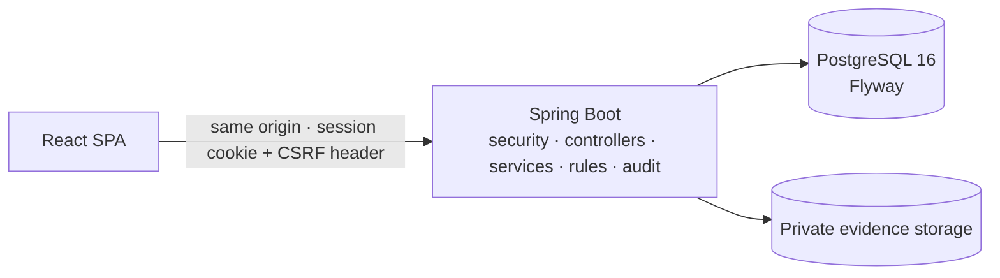

# ClaimWillow

**Insurance claims workflow and test automation platform** for a fictional home-contents insurer: policyholders
submit claims for damaged or lost belongings, deterministic rules check them, adjusters review and decide, and every
step lands in an append-only audit trail. Covered end to end by unit, integration, frontend and Cucumber/Selenium
browser tests.

> **Synthetic data only.** All people, policies, claims and files are fictional. ClaimWillow is a portfolio
> application — not a licensed insurance platform or a production claims-decision system. Do not enter real personal
> or insurance information.

## Live demo

**Coming soon.** The app is ready for free hosting on Render (Docker web service) with a Neon PostgreSQL database
([render.yaml](render.yaml), [step-by-step guide](docs/DEPLOYMENT.md#3-free-hosting-render--neon-primary-path)). The
URL will be added here once it is live.

> The free host sleeps after 15 minutes without visitors, so the first page load after a quiet spell takes a minute
> or two while the service wakes up and the JVM starts on its small CPU share. After that it responds normally.


## The problem

Claims teams need structured intake, coverage and duplicate checks, assignment, requests for missing information,
recorded decisions and a clear history. Spreadsheets and email threads lose that trail. ClaimWillow puts the whole
flow in one small, secure web application with tests that prove the rules.

## Who uses it

| Role | Can do |
| --- | --- |
| **Policyholder** | Save and submit claims against their own policies, attach evidence, answer information requests, follow status and history |
| **Claims adjuster** | Work the queue, assign claims to themselves, review findings and evidence, request information, approve or reject with a mandatory note, close |
| **Administrator** | Everything an adjuster can do, reassign claims, enable/disable demo accounts |

## Features

- **Claim intake** — three-section form (policy · incident and amount · evidence), manual draft save, a review step
  before submission, field-level errors from both the client and the server.
- **Deterministic rules R1–R6** (no AI): required inputs (blocking), policy active on the incident date, estimate over
  the coverage limit, at or below the deductible, potential duplicates (owner-scoped), completeness. Rules are named,
  versioned, explained in the UI and stored per validation run. Findings never reject a claim on their own.
- **Immutable policy snapshot** copied onto the claim at submission.
- **Review lifecycle** — `DRAFT → SUBMITTED → IN_REVIEW ⇄ NEEDS_INFO → APPROVED/REJECTED → CLOSED`; illegal transitions
  return 409; actions shown are computed by the server for the viewer's role and the claim's status.
- **Concurrency safety** — every action carries the version the user saw; conflicting assignments or decisions get a
  clear 409 with a refresh option, never a silent overwrite.
- **Append-only audit trail** — status changes, notes, evidence and rule runs, written in the same transaction as the
  change; database triggers block UPDATE/DELETE.
- **Private evidence** — PDF/PNG/JPEG checked by magic bytes, 5 MB limit, random storage keys, role-checked
  downloads.
- **Work queue** — three counts (new, in review, needs info), filters by status, assignee, reference/title/policy
  and submitted date, sorting, pagination.
- **Reports** — status counts and a formula-safe CSV export from the live database; small account admin screen.
- **Security** — server-side sessions, CSRF tokens, BCrypt, login throttling, strict security headers, 404 instead of
  leaking other users' data. See [docs/SECURITY.md](docs/SECURITY.md).

## Screenshots

Captured from a freshly seeded instance by `e2e/src/test/java/com/claimwillow/e2e/ScreenshotTour.java`.

| | |
| --- | --- |
|  Sign in |  My claims |
|  New claim form |  Claim detail (policyholder) |
|  Work queue |  Reports |
|  Work queue, narrow screen |  Review actions, narrow screen |

## Architecture

A modular monolith: one Spring Boot application serves the React app and the `/api/v1` REST API from the same origin,
backed by one PostgreSQL database and private evidence storage behind an interface.



Details, data model, trust boundaries and design reasons: [docs/ARCHITECTURE.md](docs/ARCHITECTURE.md).

## Tech stack

| Area | Choice (version) | Why |
| --- | --- | --- |
| Backend | Java 21, Spring Boot 4.1.2 (Spring Security 7, Spring Data JPA, Hibernate 7.4, Bean Validation) | Current supported Spring Boot line from Spring Initializr; mature security and transactions |
| Database | PostgreSQL 16, Flyway 12.4 | Constraints, triggers and NUMERIC money; versioned migrations |
| API docs | springdoc-openapi 3.2 | OpenAPI at `/v3/api-docs`, Swagger UI in development |
| Frontend | React 19.3, TypeScript 6.0, Vite 8.3, React Router 7.18, TanStack Query 5, Tailwind CSS 4.3 | Typed SPA, server state via queries, small design-token system |
| Backend tests | JUnit Jupiter 6, Mockito, AssertJ, Spring Boot Test, Testcontainers 2.0 | Real PostgreSQL in integration tests |
| Frontend tests | Vitest 5.1, React Testing Library 16, user-event | Component and form behaviour |
| Browser tests | Cucumber 7.34 (Gherkin), Selenium 4.52 with headless Chrome | Readable scenarios against the real app |
| Build/ops | Maven Wrapper, npm, Docker multi-stage image, Docker Compose, GitHub Actions | Reproducible local and CI runs |
| Hosting target | Azure Container Apps + Azure Database for PostgreSQL (+ private storage) | One container, one managed database; fallback documented |

## Run it locally

Prerequisites: **Java 21**, **Node 24**, **Docker**. Ports used: PostgreSQL `5434`, backend `8080`, Vite `5173`.

### Option A — everything in Docker (production image)

```bash
docker compose -p claimwillow up --build        # http://localhost:8080
docker compose -p claimwillow down              # stop (add -v to delete local data)
```

### Option B — development mode (hot reload)

```bash
docker compose -p claimwillow up -d db          # PostgreSQL on localhost:5434

cd backend
./mvnw spring-boot:run -Dspring-boot.run.profiles=local      # Windows: .\mvnw.cmd spring-boot:run "-Dspring-boot.run.profiles=local"

cd frontend
npm install
npm run dev                                     # http://localhost:5173 (proxies /api to :8080)
```

The Vite dev server proxies `/api` to Spring Boot, so the browser sees one origin: the session cookie and the
`XSRF-TOKEN` cookie work exactly as in production. The `local` profile connects to the Docker database and seeds the
synthetic demo data (idempotent; existing rows are left alone).

### Demo accounts (local development and the local Docker stack only)

Password for every account: `Willow-Demo-2026!` (a documented dev-only default from `application-local.yml` and
`docker-compose.yml`; hosted environments must set their own `APP_SEED_DEMO_PASSWORD`).

| Role | Email | Notes |
| --- | --- | --- |
| Policyholder | `priya@example.com` | Two policies (one expired), claims in several states, one draft |
| Policyholder | `marcus@example.com` | A claim waiting for more information, a closed claim |
| Policyholder | `elena@example.com` | An over-limit claim in the queue |
| Adjuster | `dana.adjuster@example.com` | Has claims in review |
| Adjuster | `sam.adjuster@example.com` | |
| Admin | `admin@example.com` | Account screen, reassignment |

### Configuration

All settings are environment variables with Spring conventions; see [.env.example](.env.example) (placeholders
only) and [docs/DEPLOYMENT.md](docs/DEPLOYMENT.md). Main ones: `SPRING_PROFILES_ACTIVE`, `SPRING_DATASOURCE_URL`,
`SPRING_DATASOURCE_USERNAME`, `SPRING_DATASOURCE_PASSWORD`, `SESSION_COOKIE_SECURE`, `APP_SEED_DEMO_DATA`,
`APP_SEED_DEMO_PASSWORD`, `ATTACHMENT_STORAGE_MODE` (`local`, `database` or `azure`), `ATTACHMENT_LOCAL_DIR`, `PORT`,
`JAVA_TOOL_OPTIONS`.

## Tests

| Layer | Command | Latest local result |
| --- | --- | --- |
| Backend unit | `cd backend && ./mvnw test` | 64 passed |
| Backend integration (Testcontainers PostgreSQL) | `cd backend && ./mvnw verify` | 45 passed |
| Frontend (lint, tests, build) | `cd frontend && npm ci && npm run lint && npm test -- --run && npm run build` | lint clean, 29 passed, build ok |
| Browser acceptance (Cucumber + Selenium) | build jar and frontend, then `cd e2e && ./mvnw test` | 10 scenarios, 96 steps passed |

Integration and browser tests start their own disposable PostgreSQL containers (Docker required) and never touch the
development database. The browser suite boots the real backend jar serving the built frontend. Full details,
scenario list and CI stages: [docs/TESTING.md](docs/TESTING.md). CI runs backend, frontend, browser and Docker image
jobs on every push and pull request ([.github/workflows/ci.yml](.github/workflows/ci.yml)).

## Demo walkthrough (about 4 minutes)

1. **Sign in as Priya** (`priya@example.com`). *My claims* shows counts by status and the list.
2. **New claim** → choose policy HC-100421, set a date, "Damaged", a title, a short description and an estimate of
   `65000`. **Save draft**, refresh the page (the draft is still there), **Review claim** → **Submit claim**.
3. The claim page shows the reference, *Submitted*, and **Automated checks**: R3 (over the 50,000 limit) and R6
   (short description, no evidence), each explained. **History** shows the submission and the rule run.
4. **Sign out, sign in as Dana** (`dana.adjuster@example.com`). The **Work queue** shows the new claim; search by its
   reference and **Open** it.
5. **Assign to me** → **Start review** → **Request more information** ("Please upload photos of the damage").
6. **Sign in as Priya** again: the claim shows the adjuster's request. Attach a PNG or PDF and send a response.
   The claim returns to *In review* and the checks re-run.
7. **As Dana**: the response and new evidence are visible. **Record a decision** → Approve with a note → confirm →
   **Close claim**. The history now holds every step with actor and time.
8. Optional: open the same claim as Sam in another browser and try to act — the server explains it is assigned to
   Dana. Show **Reports** → **Export CSV**.
9. Show the tests: `docs/TESTING.md`, the Gherkin files in `e2e/src/test/resources/features/`, and the CI workflow.

## Project structure

```
backend/    Spring Boot app (auth, user, policy, claim, validation, note, attachment, audit, report, seed)
frontend/   React + TypeScript SPA (pages, features, components, api, styles, tests)
e2e/        Cucumber + Selenium acceptance suite (own Maven module and wrapper)
docs/       ARCHITECTURE, API, USER_FLOWS, SECURITY, TESTING, DEPLOYMENT, screenshots
Dockerfile  Single production image (Vite build served by Spring Boot)
docker-compose.yml   Local PostgreSQL and the integrated app
```

## Documentation

- [Architecture](docs/ARCHITECTURE.md) — components, data model, trust boundaries, design choices
- [API](docs/API.md) — endpoints, auth model, errors, examples (OpenAPI at `/v3/api-docs`)
- [User flows](docs/USER_FLOWS.md) — roles, journeys, status transitions, business rules
- [Security](docs/SECURITY.md) — authorization matrix, file limits, threats, limitations
- [Testing](docs/TESTING.md) — test layers, scenarios, fixtures, CI
- [Deployment](docs/DEPLOYMENT.md): environment, free hosting on Render + Neon, Azure alternative, backups, rollback

## Honest limitations

- No live URL yet; the free-hosting setup is ready and the URL will be added once deployed. On the free host, the
  first request after 15 idle minutes is slow while the service wakes up.
- Synthetic data only; uploads are not scanned for malware.
- Sessions and login throttling are in memory: single instance only for now.
- Evidence is stored on a private volume (`local`) or inside PostgreSQL (`database`, used for free hosting). Azure
  Blob storage is a fail-fast placeholder.
- No payments, real adjudication, notifications, MFA or password reset — intentionally out of scope.
- No accessibility audit beyond semantic HTML, labels, focus styles, keyboard-usable controls and text-plus-colour
  status labels.

## License

[MIT](LICENSE) © 2026 Vedsai Vangapandu
