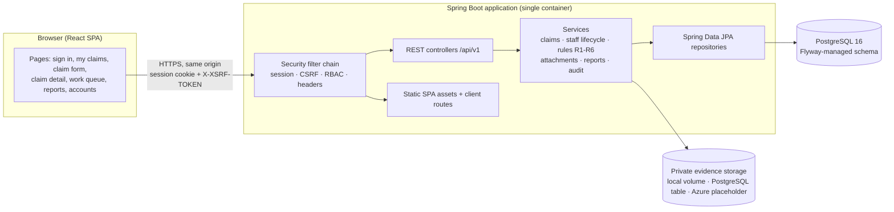
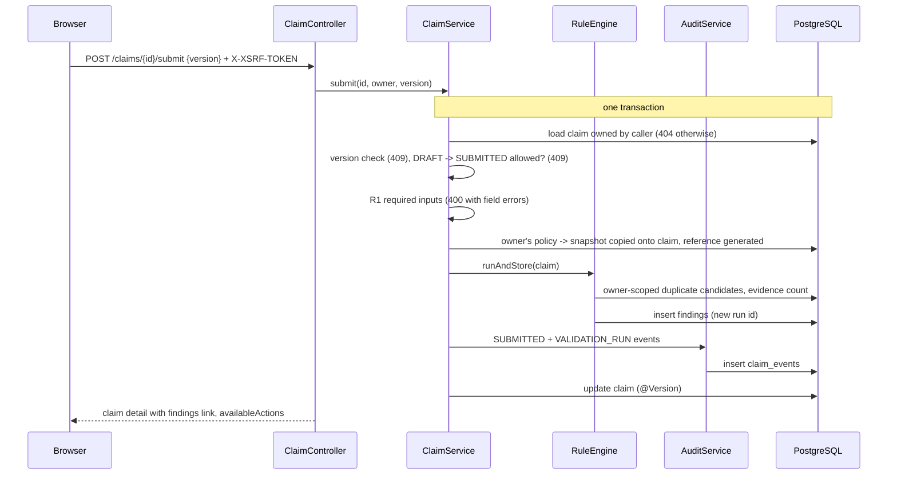
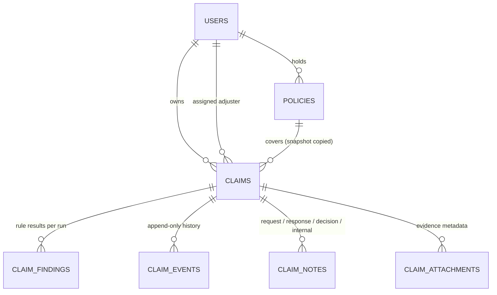

# Architecture

ClaimWillow is a **modular monolith**: one Spring Boot application owns the REST API, business rules and
persistence, and serves the compiled React single-page app from the same origin. One PostgreSQL database stores all
claim data; evidence bytes live in private storage behind an interface (a private volume, or PostgreSQL itself).

## System context

In development, Vite serves the React app on `:5173` and proxies `/api` to Spring Boot on `:8080`, so the browser
still talks to a single origin and the session/CSRF cookies behave exactly as in production.

## Backend modules

| Package | Responsibility |
| --- | --- |
| `auth` | JSON sign-in/out, current user, CSRF bootstrap, login throttling |
| `user` | Users, roles, BCrypt-backed `UserDetailsService`, admin account endpoints, display-name lookup |
| `policy` | Policies and owner/staff visibility |
| `claim` | Claim aggregate, state machine, drafts and submission, policy snapshot, staff queue and lifecycle actions, response DTOs, server-computed `availableActions` |
| `validation` | Rules R1–R6 (`RuleCode`, `ClaimRules`), rule engine, persisted findings per validation run, rule catalog |
| `note` | Request/response/decision/internal notes (append-only) |
| `attachment` | `AttachmentStorage` interface with local filesystem and PostgreSQL (`attachment_blobs`) implementations plus an Azure placeholder, magic-byte validation, upload/download |
| `audit` | Append-only `claim_events`, `AuditService` (requires an existing transaction) |
| `report` | Status summary and CSV export |
| `seed` | Opt-in synthetic demo data, created through the real services |
| `common`, `config` | Error model, request ids, security config, SPA forwarding, clock |

Controllers are thin; rules and authorization decisions live in services (`ClaimAccess`, `ClaimAction`,
`StaffClaimService`). Constructor injection everywhere; transactions are declared on service methods.

## Key data flows

### Submit a claim

### Staff decision with conflict protection

1. The UI sends the `version` it displayed.
2. `StaffClaimService` loads the claim, rejects a stale version (409 `STALE_CLAIM`), checks the caller is the
   assigned adjuster (409 `NOT_ASSIGNEE`) and the transition is legal (409 `INVALID_TRANSITION`).
3. Status change, decision note and audit event are written in one transaction; the `@Version` column makes a
   concurrent writer fail (409) rather than overwrite.
4. If any write fails, nothing is committed (proved by `DecisionRollbackIT`).

## Data model

- Flyway migrations `V1`–`V4` in `backend/src/main/resources/db/migration`; Hibernate runs with `ddl-auto=validate`.
- UUID primary keys; public claim references (`CW-2026-7KQ4MX`) are random, never sequence values.
- Money: `NUMERIC(12,2)` / `BigDecimal`. Incident date: `DATE` / `LocalDate`. Instants: `TIMESTAMPTZ`, UTC.
- Policy snapshot columns on `claims`, guarded by a trigger that rejects changes once set.
- `claim_events`, `claim_findings` and `claim_notes` reject UPDATE and DELETE via triggers; the JPA entities are
  `@Immutable` and their repositories expose no update/delete methods.
- Indexes on reference, status, assignee, owner, created time and the duplicate-lookup columns.
- `claims.version` for optimistic locking; `claims.last_validation_run_id` points at the current findings run.

## Trust boundaries

| Boundary | Controls |
| --- | --- |
| Browser → app | HTTPS (in hosting), HttpOnly/SameSite/Secure session cookie, CSRF token on every state change, CSP and other security headers, server-side validation of every field |
| Role boundary | URL rules (`/api/v1/staff/**`, `/api/v1/admin/**`), method security (`@PreAuthorize`), and per-object checks in services (`ClaimAccess`) — the UI's hidden buttons are only a convenience |
| Ownership boundary | Every claim, policy, note, finding link and attachment is resolved through the owner or staff visibility rules; anything not visible is a 404 |
| App → database | Parameterised JPA/Criteria queries only; least-privilege application role in hosting; TLS to managed PostgreSQL |
| App → evidence storage | Random server-generated keys, no user-controlled paths, storage outside any web root, downloads streamed only after authorization |

## Why a modular monolith

- One business process (claims) with strong consistency needs: state change, note and audit event must commit
  together. A single database transaction does that simply; services across a network would need sagas.
- One deployable and one origin remove CORS and cross-site cookie problems and keep CSRF straightforward.
- Package boundaries keep the code navigable; any module could be extracted later behind its interface if load or
  team structure ever required it.

## Storage choice

- PostgreSQL for all structured data: transactional, constraint-rich (CHECKs, FKs, triggers), supported by Flyway
  and by Azure Database for PostgreSQL.
- Evidence bytes behind `AttachmentStorage`, selected by `ATTACHMENT_STORAGE_MODE`:
  - `local`: a private directory on a persistent volume. Used for development and the local Docker stack.
  - `database`: the `attachment_blobs` table (migration V5). Used for hosts without a persistent disk, such as the
    free Render web service. Properties:
    - Rows are keyed by the same random storage key as `claim_attachments`, and the bytes are written in the
      upload's own transaction, so metadata and content commit or roll back together.
    - The foreign key to `claim_attachments.storage_key` is `DEFERRABLE INITIALLY DEFERRED`. It is checked at
      commit, so bytes can never be committed without their metadata row.
    - The key uses `ON DELETE CASCADE`, so if metadata is ever removed (for example in a demo reset), its bytes go
      with it.
    - A trigger rejects `UPDATE`, so stored evidence is immutable, in line with the append-only audit tables.
    - The column uses `STORAGE EXTERNAL`, so already-compressed PDF/PNG/JPEG files are not recompressed.
    - Files are at most 5 MB and 10 per claim, which keeps a free database tier comfortably sized. Evidence is also
      covered by the ordinary database backups.
  - `azure`: a deliberate fail-fast placeholder until cloud resources exist (see [DEPLOYMENT.md](DEPLOYMENT.md)).
- Concurrency: every state-changing claim operation first loads the claim with `SELECT ... FOR UPDATE`. Concurrent
  writers queue on that row lock rather than deadlocking on the foreign-key locks taken by the events, notes and
  attachments they insert. The `@Version` check then turns the losing request into a clean 409.

## Frontend

React 19 + TypeScript + Vite, React Router for routes, TanStack Query for server state (no client-side copies of
domain data), Tailwind CSS v4 with a small token set (`src/styles/index.css`). Pages live in `src/pages`, feature
components in `src/features`, shared UI in `src/components`, the API client in `src/api`. The client reads the
`XSRF-TOKEN` cookie and sends `X-XSRF-TOKEN`; route guards only improve navigation — the backend decides.
