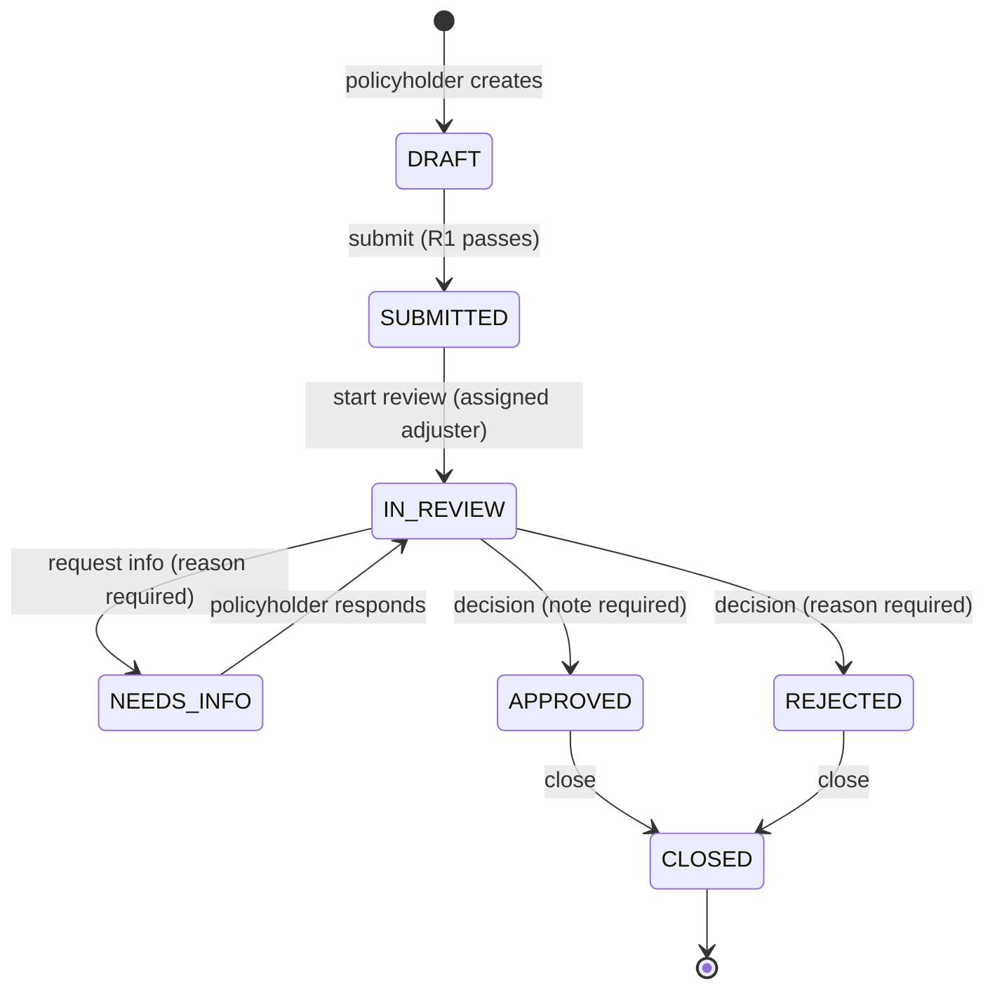

# User flows and business rules

All people, policies and claims in ClaimWillow are fictional.

## Roles

| Role | What they do |
| --- | --- |
| Policyholder | Starts claims for their own policies, saves drafts, submits, answers information requests, follows status and history. |
| Adjuster | Works the queue: assigns claims to themselves, reviews findings and evidence, requests information, approves or rejects, closes. |
| Admin | Everything an adjuster can do, plus reassigning claims to another adjuster, closing any decided claim and viewing accounts. |

Staff cannot create or submit claims; policyholders cannot call any staff endpoint. Every rule is enforced by the
backend; hidden buttons in the UI are a convenience, not the control.

## Claim lifecycle

- Any other transition returns **HTTP 409** `INVALID_TRANSITION` with the current status and the allowed next statuses.
- Every status change writes an audit event (actor, time, previous and new status, summary) in the same database
  transaction as the change. Audit events, findings and notes are append-only; database triggers reject UPDATE/DELETE.
- Every staff action and every draft save carries the claim `version` the user saw. If someone else changed the claim
  in the meantime the request fails with **409** `STALE_CLAIM` and the UI offers a refresh. Concurrent writes that
  slip past that check are caught by the `@Version` column (also 409).
- Assignment is race-safe: an adjuster can only take an unassigned claim (409 `ALREADY_ASSIGNED` otherwise); only an
  admin can reassign.

## Flow A: policyholder submits a claim

1. Sign in, open **My claims** (status counts, filter, search by reference or title).
2. **New claim** — section 1 policy, section 2 incident date, damaged or lost, title, description, estimate in CAD,
   section 3 evidence.
3. **Save draft** at any time; drafts can be reopened and edited until submitted.
4. **Review claim** shows a summary; **Submit claim** then:
   - validates R1 (blocking),
   - assigns a public reference such as `CW-2026-7KQ4MX` (random, never a database sequence),
   - copies the policy terms into an immutable snapshot on the claim,
   - runs R2–R6 and stores the findings as a validation run,
   - writes `SUBMITTED` and `VALIDATION_RUN` events.
5. The claim page shows status, findings with explanations, and the history timeline.

## Flow B: adjuster reviews and decides

1. **Work queue** shows three counts (new, in review, needs info) and a table filterable by status, assignee,
   reference/title/policy number and submitted date range, with sorting.
2. Opening a claim shows the description, findings, notes, history, summary facts and policy snapshot, with a
   decision panel on the right (stacked on mobile).
3. **Assign to me**, then **Start review**.
4. **Request information** (reason required), **Approve** (decision note required) or **Reject** (reason required).
   Decisions and closing ask for confirmation.
5. **Close** an approved or rejected claim.
6. Internal notes are visible to staff only.

## Flow C: policyholder answers a request

1. The claim shows **The adjuster needs more information** with the adjuster's message.
2. The policyholder writes a response and/or attaches evidence (a written answer is optional only when a new file was
   attached after the request).
3. Sending moves the claim back to IN_REVIEW, re-runs the rules and records what changed (for example
   "Automated checks re-ran: 1 finding (R6). Previously 3.").

## Deterministic rules (no AI)

Rules live in `backend/src/main/java/com/claimwillow/validation/` (`RuleCode`, `ClaimRules`). Each has a short code,
a version and a plain-language description served by `GET /api/v1/rules` and shown in the UI. Findings never reject a
claim on their own; staff record the decision.

| Code | Name | Behaviour | Severity |
| --- | --- | --- | --- |
| R1 | Required inputs | Policy you hold, incident date (not in the future), damaged/lost, title, description, estimate >= 0.01 CAD. Blocks submission with field errors (HTTP 400). | blocking |
| R2 | Policy active on incident date | Incident date outside the snapshot's effective–expiration dates (inclusive) → `COVERAGE_REVIEW_REQUIRED`. | warning |
| R3 | Estimate vs coverage limit | Estimate greater than the snapshot coverage limit → `OVER_LIMIT`. | warning |
| R4 | Deductible | Estimate at or below the deductible → `BELOW_DEDUCTIBLE`; context only, no payable amount is calculated. | info |
| R5 | Potential duplicate | Same owner, same policy, same incident type, incident dates within 7 days, estimates within 20% of the larger amount → `POTENTIAL_DUPLICATE`, linked to the earlier claim. Only the owner's own claims are ever compared. | warning |
| R6 | Completeness | Description shorter than 60 characters, or no evidence attached → `INFORMATION_RECOMMENDED`. | info |

Window, tolerance and minimum description length are configured in `application.yml` (`app.rules.*`), never by the
browser. Money is `NUMERIC(12,2)` / `BigDecimal`; incident dates are `LocalDate`; instants are stored in UTC and shown
in the viewer's time zone.
